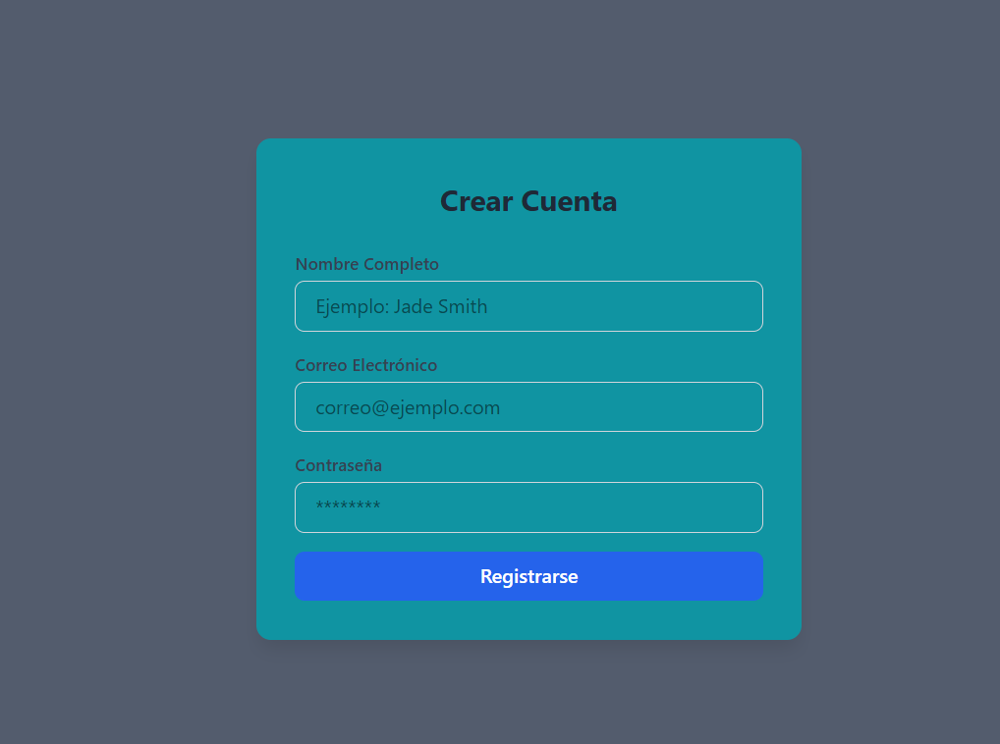

# Proyecto - Primera Entrega

Este proyecto es la base para el desarrollo de un formulario inicial, que después será una aplicación web construida con **React** y **Vite**, que integra **Tailwind CSS** para un diseño moderno y responsivo, y **React Hook Form** para la gestión y validación eficiente de formularios.



## 🚀 Tecnologías Utilizadas

*   [React](https://reactjs.org/) - Biblioteca para interfaces de usuario.
*   [Vite](https://vitejs.dev/) - Herramienta de construcción y servidor de desarrollo.
*   [Tailwind CSS](https://tailwindcss.com/) - Framework de CSS para estilos rápidos.
*   [React Hook Form](https://react-hook-form.com/) - Gestión y validación de formularios.

## 🛠️ Instalación y Uso Local

Si deseas correr este proyecto en tu máquina local, sigue estos pasos:

1. Clona el repositorio:
   ```bash
   git clone https://github.com/TU_USUARIO/TU_REPOSITORIO.git